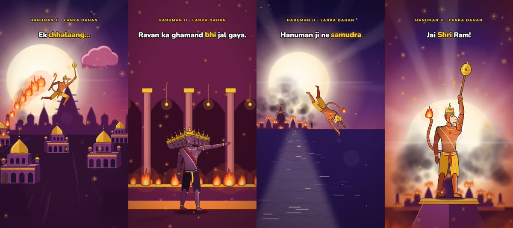

# Cinematic Pauranik Reel Studio (2.5D)

Apni awaaz + apni script do → **cinematic 2.5D animated reel** banti hai: roshni, gehraai (depth), asli insaan jaise shareer, hilte honth, shabd-dar-shabd sunehre subtitles, background music aur sound effects. 1080×1920, Instagram Reels / YouTube Shorts ke liye.

Is template ke saath wali guide ("AI Se Cinematic Pauranik Reels") mein har step screenshots ke saath samjhaya gaya hai. **Ye template sirf guide kharidne walon ke liye hai** (LICENSE dekho).

## Har reel ke 3 kaam (aapke)
1. GitHub par `reels/<naam>/script.txt` banao (Roman Hinglish, har line ek saans, khaali line = naya scene).
2. Usi folder mein apni awaaz (ElevenLabs MP3) upload karo. Folder mein ek hi audio.
3. Claude app → Code → is repo ki nayi session → guide ka **Prompt 4** bhejo.

Baaki sab Claude karta hai: kahani samajhna, characters design karna, har scene ka camera aur roshni, music + effects, 15 second ka preview, badlaav, aur poori reel.

## Saare prompts
[PROMPTS.md](PROMPTS.md) kholo. Har prompt ke box mein upar right par **copy** ka button hai (phone par bhi).

## Example
`reels/example/` mein ek demo hai (awaaz ki jagah sirf "bhunbhun" hum, sirf test ke liye):
`npm run preview -- example` aur `npm run reel -- example`.

## Commands (Claude ke liye)
| Command | Kya karta hai |
|---|---|
| `npm run preview -- <naam>` | `reels/<naam>/preview.mp4` (pehle 15 s) + `check.jpg` |
| `npm run reel -- <naam>` | `reels/<naam>/reel.mp4` (poora) |
| `npm run ref -- <naam>` | `reels/<naam>/ref/` ki reference video se style ka analysis |
| `npm run library` | `docs/library.png` (character rig + light presets) |
| `bash setup.sh` | ffmpeg + npm packages (cloud par commands khud chala lete hain) |

Claude ke niyam: [CLAUDE.md](CLAUDE.md). Banane ka tareeka (skill): `.claude/skills/cinematic-reel/`.
